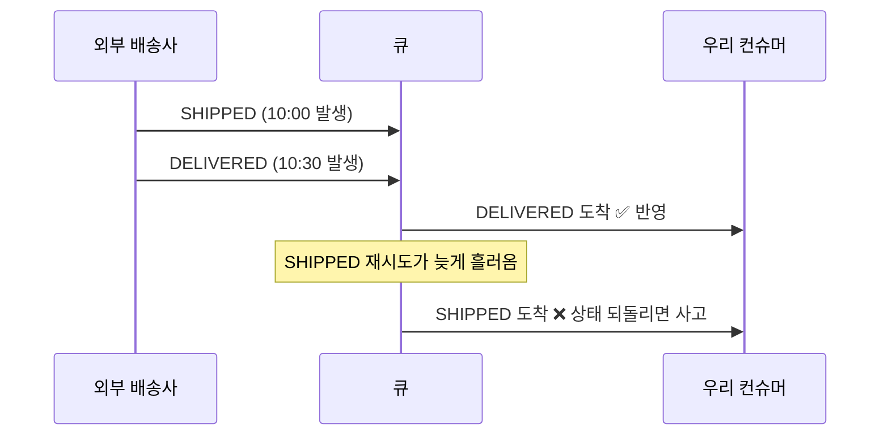

# 04 — 이벤트: 중복과 순서 역전

> 외부 시스템이 보내는 이벤트는 **중복되고, 순서가 뒤바뀌고, 유실된다.** 셋 다 정상 동작이다.

**대상 코드**: `stage4/ShipmentTracker.java`
**완료 기준**: `./gradlew s4` 초록 + 어떤 순서로 던져도 최종 상태 동일

---

## 1. 문제

메시지 브로커의 기본 보장은 **at-least-once** — "최소 한 번" 이지 "정확히 한 번" 이 아니다.



이런 일이 왜 생기나:
- **재시도**: 컨슈머가 ack 를 못 보내면 브로커가 다시 보낸다
- **파티션**: Kafka 는 파티션 <b>안에서만</b> 순서를 보장한다. 키를 안 잡으면 같은 배송 건의 이벤트가 다른 파티션으로 흩어진다
- **컨슈머 다중화**: 인스턴스 3대가 병렬 소비하면 처리 순서는 도착 순서와 다르다
- **외부 발신자**: 애초에 순서대로 안 보낸다

> ⚠️ **"배송 완료 알림을 본 고객 화면이 다시 '배송 중' 으로 돌아가는" 사고**는 이 셋 중 하나 때문에 매우 흔하게 난다.

---

## 2. 세 겹의 방어

```
1. 중복 제거     같은 eventId 두 번    → DUPLICATE
2. 순서 역전 방어  과거 상태가 늦게 도착  → STALE
3. 전이 검증     규칙에 없는 변화       → INVALID
```

### 판정 순서가 정책이다

권장: **중복 → stale → 전이 검증**. 이미 처리한 이벤트를 다시 검증할 이유가 없다.

순서를 바꾸면 "중복이면서 무효한 이벤트" 의 라벨이 달라진다. 정답은 하나가 아니지만 **정한 순서를 말할 수 있어야** 한다.

### 왜 boolean 이 아니라 enum 인가

이게 이 스테이지에서 설명 가치가 가장 높은 지점이다.

| 결과 | 정상? | 운영 대응 |
|---|---|---|
| `APPLIED` | — | 반영됨 |
| `DUPLICATE` | 정상 | 무시. 재시도가 잘 동작한 것 |
| `STALE` | 정상 | 무시. 다만 급증하면 상류 재처리 신호 |
| `INVALID` | **비정상** | **알람.** 우리 모델이 현실과 어긋났다는 뜻 |

`false` 하나로 뭉치면 대시보드에 "무시 3,000건" 만 보인다. 그중 진짜 문제가 몇 건인지 알 수 없다.
**DUPLICATE 는 평평하고 INVALID 만 튀는** 그림을 볼 수 있어야 한다.

> 💡 **실무**: 반환 타입 설계가 곧 관측성 설계다. 이 관점을 말할 수 있으면 "운영을 해본 사람" 으로 읽힌다.

---

## 3. 순서 무관성(가환성)

이 스테이지가 진짜로 만드는 성질은 이것이다:

> **어떤 순서로 이벤트를 던져도 최종 상태가 같다.**

수학 용어로 가환성(commutativity). 실무 용어로는 **"재처리해도 안전하다"**.

이 성질이 있으면:
- 장애 후 이벤트를 통째로 재처리해도 된다
- 컨슈머를 늘려 병렬 소비해도 된다
- 순서 보장을 위해 파티션을 1개로 묶는 (= 처리량을 버리는) 선택을 안 해도 된다

**테스트로 강제하는 법**: 같은 이벤트 집합을 정상 순서 / 역순 / 뒤죽박죽으로 각각 던지고, 세 경우의 최종 상태가 같은지 확인한다.

---

## 4. rank 를 명시적으로 두는 이유

```java
READY(10), SHIPPED(20), IN_TRANSIT(30), ...
```

`ordinal()` 로도 되는데 왜 int 를 손으로 쓰나?

- enum 상수 순서를 바꾸면 `ordinal` 이 **조용히** 달라진다. 비즈니스 의미를 코드 순서에 의존시키면 안 된다
- 중간에 상태를 끼워넣을 여지 (10, 20, 30 사이는 비어 있다)
- DB 에 저장할 때도 같은 원칙 — enum 을 `ORDINAL` 로 저장하면 상수 하나 추가에 기존 데이터가 전부 어긋난다. **`STRING` 으로 저장한다**

> ⚠️ **함정**: JPA `@Enumerated` 의 기본값이 `ORDINAL` 이다. 명시적으로 `@Enumerated(EnumType.STRING)` 을 써야 한다. 이 한 줄 때문에 데이터가 통째로 밀린 사고가 흔하다.

---

## 5. 확장 질문

### Q1. 외부가 eventId 를 안 주면?

<details><summary>답</summary>

직접 만든다. 재현 가능한 값이어야 한다 — 같은 이벤트에서 항상 같은 ID 가 나와야 하므로 **수신 시각이나 UUID 를 쓰면 안 된다.**

```
eventId = hash(shipmentId + status + occurredAt)
```

`occurredAt` 의 정밀도가 낮으면(초 단위) 서로 다른 이벤트가 같은 해시를 가질 수 있다. 그 위험을 받아들일지, 페이로드 전체를 해시할지 결정한다.

정말 아무 식별자도 없으면 마지막 수단: **(shipmentId, status) 조합을 한 번만 처리** — 같은 상태 재통지를 전부 중복으로 본다. 재배송처럼 진짜 반복이 필요한 경우를 놓친다는 대가가 있다.
</details>

### Q2. 처리한 eventId 를 무한히 저장할 수는 없다

<details><summary>답</summary>

메모리 `Set` 은 계속 커진다. 실서비스 선택지:

| 방법 | 특징 |
|---|---|
| **DB 테이블 + unique 제약** | 가장 견고. `INSERT` 실패 = 중복. 처리 결과와 같은 트랜잭션에 묶을 수 있다 |
| Redis + TTL | 빠름. 유실 시 중복 처리 가능 → 처리가 멱등하면 괜찮다 |
| 시간 윈도우 | "최근 N일" 만 보관. 그보다 늦게 온 중복은 못 잡는다 |

**가장 좋은 건 처리 자체를 멱등하게 만드는 것**이다. 중복 판정이 뚫려도 결과가 같으면 문제가 안 된다.
`UPDATE shipment SET status='DELIVERED' WHERE id=? AND status_rank < 50` — 이건 몇 번 실행해도 같다.

> ✗→✓ **오해**: "중복 제거 = eventId Set" → **정정**: eventId 는 1차 방어일 뿐. **최종 방어는 연산 자체의 멱등성**이다.
</details>

### Q3. 발생 시각과 상태 rank 가 어긋나면?

<details><summary>답</summary>

발생 시각은 더 최근인데 rank 는 더 낮은 이벤트 — 예: 배송 완료 후 실제로 반송되어 다시 '배송 중' 이 된 경우.

**무엇을 신뢰할 것인가의 문제다.**

| 신뢰 대상 | 결과 | 위험 |
|---|---|---|
| rank | 상태는 절대 후퇴하지 않는다. 단순하고 안전 | 진짜 후퇴(재배송)를 놓친다 |
| occurredAt | 후퇴를 반영한다 | **외부 시계를 믿어야 한다** — 시계 오차, 타임존 버그에 취약 |

실무 절충: **rank 를 기본으로 하되, 후퇴가 정당한 전이(DELIVERED → RETURNED)는 전이표에 명시적으로 허용**한다. 즉 "시각을 믿는" 게 아니라 "허용된 후퇴만 허용" 하는 것.

> 💡 외부 시스템이 준 타임스탬프를 순서 결정에 쓸 때는 항상 의심한다. 우리 시계와 저쪽 시계는 다르다.
</details>

### Q4. 이벤트가 아예 유실되면?

<details><summary>답</summary>

중복과 순서는 코드로 막지만, **유실은 코드로 못 막는다.** 안 온 걸 알 방법이 없기 때문이다.

그래서 필요한 게 **대사(reconciliation)** 다.

1. 주기적으로 외부 시스템에 현재 상태를 조회(polling)해서 우리 상태와 비교
2. 어긋난 건을 찾아 보정
3. 어긋난 건수를 메트릭으로 남긴다 — 이 값이 늘면 이벤트 경로에 문제가 있다는 뜻

**"이벤트로 실시간 반영 + 배치로 대사"** 는 외부 연동의 기본 구성이다. 이벤트만 믿는 설계는 언젠가 조용히 틀어진다.

추가로: 오래 상태가 안 바뀌는 건을 찾는 **stuck 감지**도 같이 둔다. `SHIPPED 인 채로 7일 경과` 같은 조건.
</details>

### Q5. 재시도해도 계속 실패하는 이벤트는?

<details><summary>답</summary>

무한 재시도는 **큐를 막는다** (head-of-line blocking). 뒤에 있는 정상 이벤트까지 전부 멈춘다.

- **재시도 가능한 실패**와 **불가능한 실패**를 나눈다. 네트워크 타임아웃은 재시도, 파싱 실패·스키마 불일치는 재시도해도 소용없다
- 재시도는 **지수 백오프 + jitter**. 고정 간격으로 동시에 재시도하면 복구 중인 상대를 다시 넘어뜨린다
- N회 초과하면 **DLQ(dead letter queue)** 로 보낸다

DLQ 는 넣는 게 끝이 아니다. 세 가지가 같이 있어야 한다:
1. DLQ 적재 시 **알람** (조용히 쌓이면 없는 것과 같다)
2. **원본 메시지 + 실패 사유**를 함께 저장 (사유 없이 메시지만 있으면 조사 불가)
3. 고친 뒤 **재투입하는 경로** — 이게 없어서 DLQ가 무덤이 되는 경우가 태반이다
</details>

---

## 6. 자가 점검

- [ ] 세 겹 방어(중복/stale/전이)를 모두 구현했다
- [ ] 판정 순서를 정하고 이유를 말할 수 있다
- [ ] 결과를 enum 으로 나눈 이유를 운영 관점에서 설명할 수 있다
- [ ] 순서를 뒤섞어도 최종 상태가 같은 테스트가 있다
- [ ] 단계 건너뛰기를 허용한 이유를 말할 수 있다
- [ ] `ordinal()` 대신 명시적 rank 를 쓴 이유를 안다
- [ ] 유실은 코드가 아니라 대사로 잡는다는 걸 안다
- [ ] DLQ 에 필요한 세 가지(알람/사유/재투입)를 말할 수 있다

---

**이전** ← [03 — 동시성과 재고](03-concurrency-and-stock.md) · **다음** → [05 — 우선순위 배분](05-priority-dispatch.md)
