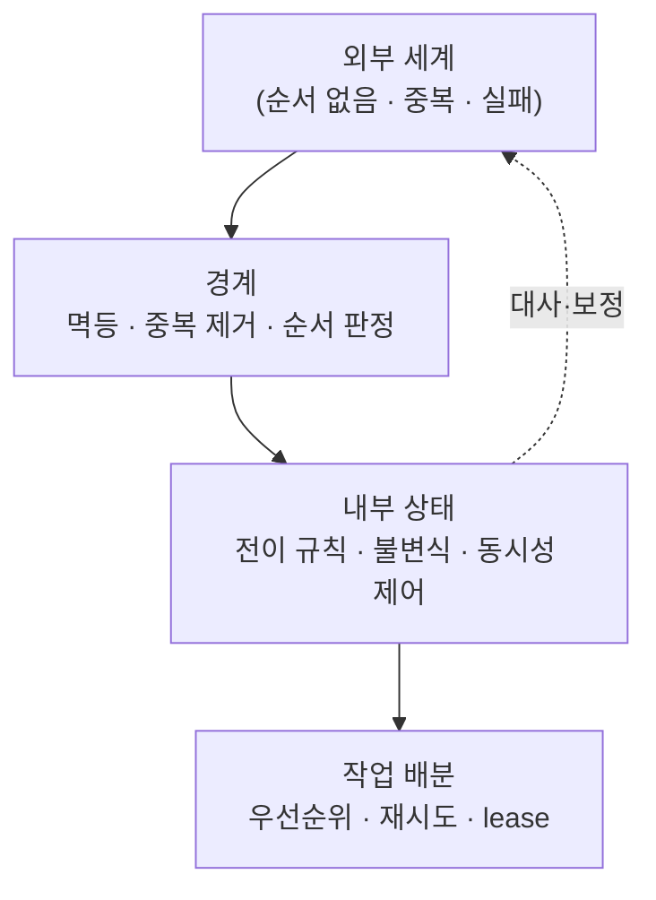

# docs — 학습 지도

**주문 흐름을 소재로 "외부 시스템과 내부 상태를 어긋나지 않게 유지하는" 다섯 가지 문제를 60분 단위로 연습한다.**
각 노트는 코드가 초록이 된 뒤에 읽는 확장 질문을 담고 있다 — 코드보다 **확장 질문이 본체**다.
정답은 `<details>` 로 접혀 있으니 반드시 먼저 답해보고 펼친다.

---

## 읽는 순서

| 노트 | 한 줄 |
|---|---|
| [01 — 상태 전이](01-state-transition.md) | 규칙을 `if` 가 아니라 데이터로 두면, 상태가 늘어도 안 깨진다 |
| [02 — 멱등성](02-idempotency.md) | "응답을 못 받았다" 와 "처리가 안 됐다" 는 구분할 수 없다 |
| [03 — 동시성과 재고](03-concurrency-and-stock.md) | check-then-act 사이의 틈은 트래픽이 있으면 반드시 뚫린다 |
| [04 — 이벤트 순서와 중복](04-event-ordering.md) | 중복·순서 역전·유실은 사고가 아니라 정상 동작이다 |
| [05 — 우선순위 배분](05-priority-dispatch.md) | 정렬 기준을 바꾸면 SLA 위반 건수가 바뀐다 |
| [10 — 60분 드릴 운영법](10-timeboxed-drill.md) | 평가되는 건 완성된 코드가 아니라 진행 방식이다 |
| [20 — 키워드 지도](20-keyword-map.md) | 이미 한 것을 상대의 어휘로 옮기는 작업 |

01→05 는 난이도 순이 아니라 **의존 순**이다. 02의 멱등성은 04·05에서 다시 나오고, 03의 락 논의는 05의 워커 동시성으로 이어진다.

---

## 다섯 노트를 관통하는 것



- 왼쪽은 **통제할 수 없다** — 순서도 횟수도 상대가 정한다
- 가운데 경계에서 걸러낸다 — 02, 04
- 안쪽은 규칙과 불변식으로 지킨다 — 01, 03
- 오른쪽으로 내보낸다 — 05
- 그래도 어긋나므로 **주기적으로 대사한다** — 04 Q4

**유실은 코드로 못 막는다. 대사로 잡는다.** 이 한 줄이 다섯 노트를 통틀어 가장 중요한 문장이다.

---

## 노트 표기

| 표기 | 뜻 |
|---|---|
| ⚠️ **함정** | 실제로 시간을 태우거나 사고를 내는 지점 |
| ✗→✓ **오해** | 흔한 오해와 정정 |
| 💡 **실무** | 코드 바깥의 판단 |
| 📖 **근거** | 공식 문서 링크 (기억이 아니라 문서로) |

---

## 완료 기준

```
5개 스테이지 전부 초록  +  각 노트의 자가 점검 전 항목 체크
+ 무작위 스테이지 1개를 사전 준비 없이 60분 안에 완주
```

마지막 항목이 진짜 기준이다. 답을 아는 문제를 다시 푸는 건 워밍업이다.
