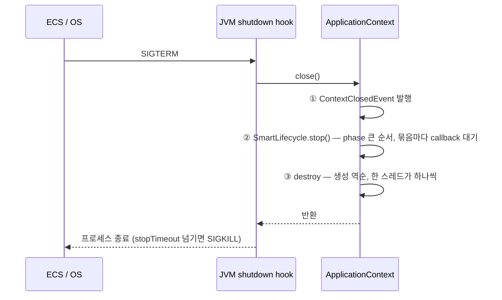

# 01. 종료의 세 단계

`context.close()` 는 아래 세 줄로 요약된다. 순서는 바뀌지 않고, 단계끼리 겹치지도 않는다.

```java
// AbstractApplicationContext.doClose() 요약 (spring-context 6.2)
publishEvent(new ContextClosedEvent(this));   // ① 종료 이벤트
this.lifecycleProcessor.onClose();            // ② Lifecycle stop
destroyBeans();                               // ③ Bean destroy
```



| 단계 | 누가 불리나 | 성격 |
|---|---|---|
| ① 종료 이벤트 | `ApplicationListener<ContextClosedEvent>` | 알림. 아직 아무것도 멈추지 않았다 |
| ② Lifecycle stop | `Lifecycle` / `SmartLifecycle` 의 `stop()` | 하던 일을 멈춘다. 다시 `start()` 할 수 있다 |
| ③ Bean destroy | `@PreDestroy` · `DisposableBean.destroy()` · `destroyMethod` · `AutoCloseable.close()` | 빈을 폐기한다. 이후로는 쓸 수 없다 |

> 📊 **측정** (2026-10-14, T-01, `./gradlew s1`)
> ```
> ① ContextClosedEvent 수신
> ② stop phase=1000 web-like
> ② stop phase=0 redis-like
> ② stop phase=-1000 mq-like
> ③ destroy third        ← 생성: first → second → third
> ③ destroy second
> ③ destroy first
> ```

## 한 빈 안의 destroy 순서 (T-01b)

`@PreDestroy` → `DisposableBean.destroy()` → `destroyMethod`. 셋 다 ③ 에서 한 빈을 정리할 때 연달아 불린다.

`@Bean` 으로 등록한 객체가 `close()` 나 `shutdown()` 을 가지고 있으면 Spring 이 destroy 메서드로 추론해 부른다. `HikariDataSource` 가 따로 설정하지 않아도 닫히는 이유다.

> ✗→✓ **오해**: "`@PreDestroy` 는 종료 이벤트를 받자마자 불린다"
> → ③ 에서 불린다. 그 전에 ② 의 모든 `SmartLifecycle` 이 이미 멈췄다. `@PreDestroy` 안에서 Redis 를 쓰면 실패한다 (Lettuce 는 ② 에서 멈춤, [04](04-resources.md)).

## destroy 는 동기다 (T-02)

```java
// DefaultSingletonBeanRegistry.destroySingletons() (spring-beans 6.2)
for (int i = disposableBeanNames.length - 1; i >= 0; i--) {   // 등록 역순
    destroySingleton(disposableBeanNames[i]);                   // 끝나야 다음 빈
}
```

> 📊 **측정** (2026-10-14, T-02, `./gradlew s1`) — destroy 가 300ms 걸리는 빈 2개
> ```
> [    0ms] [Test worker] ③ slow-2 destroy 시작
> [  306ms] [Test worker] ③ slow-2 destroy 끝
> [  306ms] [Test worker] ③ slow-1 destroy 시작
> [  606ms] [Test worker] ③ slow-1 destroy 끝
> ```
> close 를 부른 스레드 하나가 차례로 처리한다. 한 빈의 destroy 가 막혀 있으면 **그 뒤 빈들은 전부 기다린다.**

> 💡 **실무**: 이 성질 때문에 `ThreadPoolTaskExecutor.setAwaitTerminationSeconds()` 가 "다른 빈의 destroy 를 붙잡아 두는" 효과를 낸다. 다만 붙잡을 수 있는 건 **③ 에서 그 풀보다 뒤에 닫히는 빈**뿐이다. ② 에서 이미 멈춘 것은 살릴 수 없다 → [03](03-executor-modes.md).

## 의존 관계와 순서

- **destroy:** 다른 빈에 의존하는 빈이 먼저 destroy 된다 (`@DependsOn`, 생성자 주입 모두). 의존이 없으면 생성 역순이다.
- **lifecycle stop:** 어떤 빈을 멈추기 전에, 그 빈에 의존하는 빈을 먼저 멈춘다 (`DefaultLifecycleProcessor.doStop()`). phase 가 작아도 의존 관계 때문에 일찍 멈출 수 있다.

> ⚠️ **함정**: executor 빈은 보통 DataSource·Rabbit 연결 팩토리에 의존하지 않는다. 그래서 ③ 에서 무엇이 먼저 닫힐지는 **우연히 정해진 생성 순서**에 달린다. T-07c 가 순서를 뒤집어 DB 실패를 만든다.

> 📖 **근거**
> - [Spring Framework 레퍼런스 — Startup and Shutdown Callbacks](https://docs.spring.io/spring-framework/reference/core/beans/factory-nature.html)
> - [SmartLifecycle Javadoc (6.2.x)](https://docs.spring.io/spring-framework/docs/6.2.x/javadoc-api/org/springframework/context/SmartLifecycle.html)
